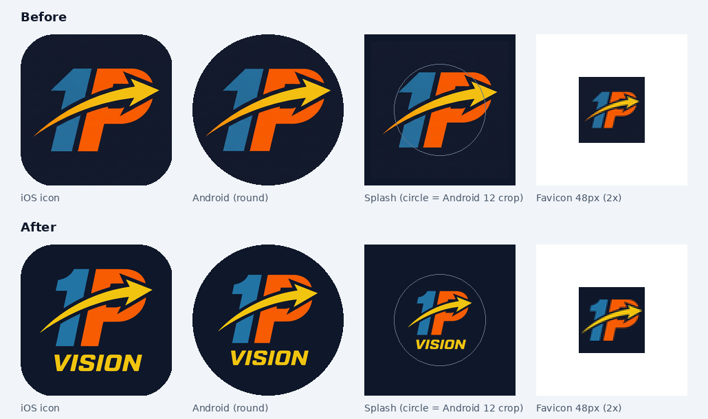
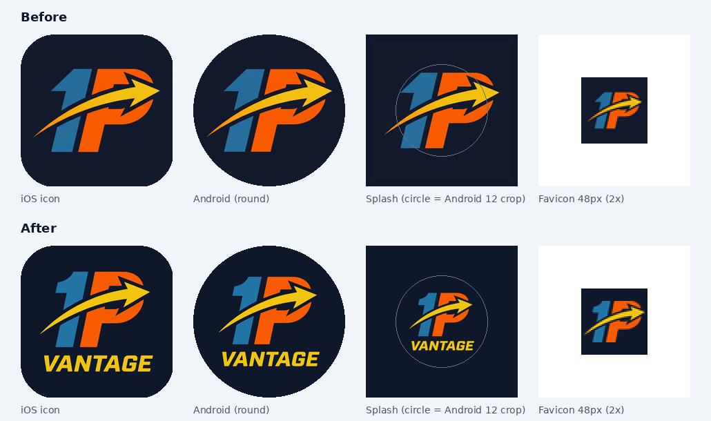
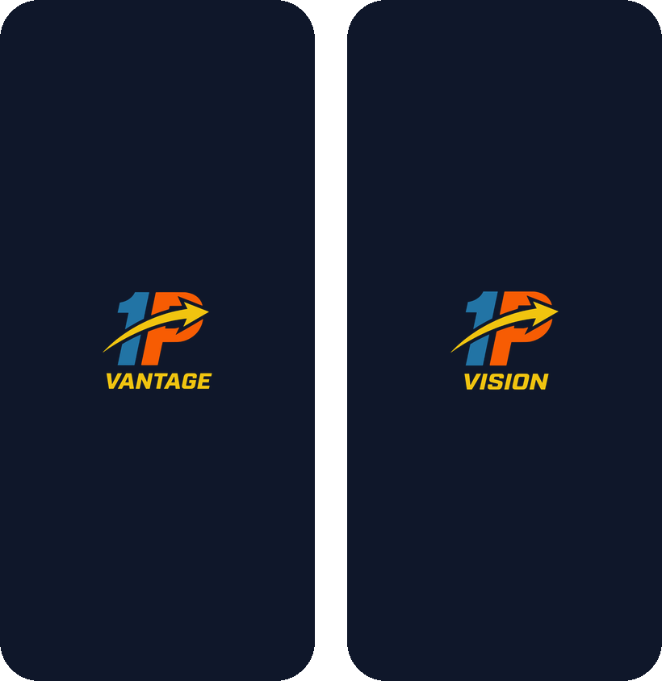

# Vision and Vantage app icons

Reference sheet for the FirstPass Vision and FirstPass Vantage app icons. `index.html` is the same page as the review artifact; the images below show it on GitHub.

The icons are rendered from the vector logos in `img/`, which were traced from Matt's artwork with the colours set to the brand palette (blue `#2274A5`, orange `#F75C03`, gold `#F1C40F`, navy `#0F172A`).

## FirstPass Vision

The Android tile shows what the launcher displays (the middle 72 of 108 units). The circle on the splash is the area Android 12 and later shows.

## FirstPass Vantage

## Opening screen

The splash logo is drawn 288 points wide on Deep Navy and sits inside the Android 12 circle.

## Vector logos

| File | Use |
| --- | --- |
| `img/firstpass-vision-stacked.svg`, `img/firstpass-vantage-stacked.svg` | Transparent logo |
| `*-dark-card.svg`, `*-light-card.svg` | Logo on navy or light grey |
| `img/firstpass-mark.svg` | 1P mark on its own (favicons) |

## Regenerating

Scripts in `scripts/` (Python with Pillow, numpy, opencv-python-headless and potracer):

1. `trace_logo.py <artwork.jpeg> <vision|vantage> <out-dir>` traces the dark panel of the artwork to SVG.
2. Render each SVG to a transparent PNG about 2048 px wide (any SVG renderer).
3. `make_app_icons.py <logo.png> <mark.png> apps/<app>/assets` writes `icon.png`, `adaptive-icon.png`, `splash-icon.png` and `favicon.png`.
4. `make_splash.py <logo.png> apps/<app>/assets/splash-icon.png` replaces the splash with the version padded for the Android 12 circle.
